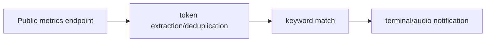

# Token Discovery Alerts

**Keyword-filtered token notifications in your terminal, with optional local audio.**

  [](LICENSE)

[Overview](#overview) · [Quickstart](#quickstart) · [Example](#example) · [Validation](#validation) · [Documentation](#documentation)

## Overview

A small Python polling tool for detecting newly observed tokens and emitting configurable local audio alerts.

**Stack:** Python · requests · argparse · platform-specific audio helpers

## A small polling utility

| Component | Behavior |
| --- | --- |
| Extract | Supported response envelopes provide a token list. |
| Match | Keywords inspect name, symbol and reserve-currency fields. |
| Notify | Terminal labels are sanitized before optional audio notification. |

## Processing path



## Quickstart

```console
python -m pip install requests
python listener.py --help
```

The commands above install prerequisites or run the specified offline checks. Live collection, cloud operations, messaging and trading are separate operational steps when present.

## Example

**Inspect the workflow**

Inspect the CLI arguments before selecting an endpoint and keyword filter. Newly observed tokens are deduplicated within the running process. Audio depends on the local platform; a restart starts a new in-memory seen-token set.

## Configuration and storage

The implementation uses requests, argparse and platform-specific audio helpers. There is no application database, background service manager or durable resume store.

## Repository guide

| Location | Responsibility |
| --- | --- |
| [listener.py](listener.py) | Polling, filtering and local notification |

## Validation

The quickstart lists the declared checks. No passing CI or coverage claim is implied by the technology badges.

## Scope and operational boundaries

No dedicated test suite or pinned dependency file is bundled. CLI help does not test endpoint response compatibility or audio output. The operational entrypoint polls an external source.

## Documentation

- The repository guide above links directly to the implementation and configuration files.

## License and attribution

Project-authored source code is licensed under the [MIT License](LICENSE). Third-party components and datasets retain their respective rights and licenses.
